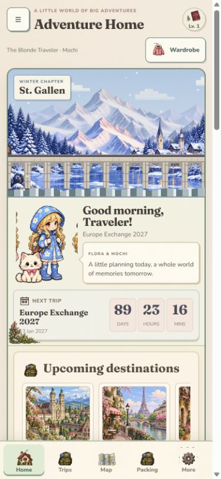
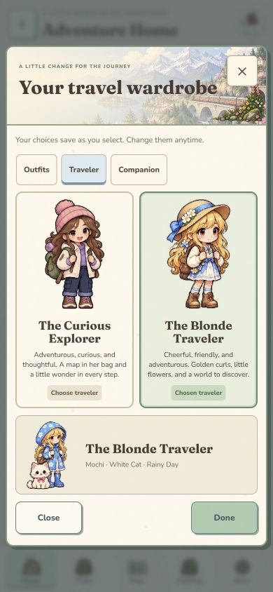
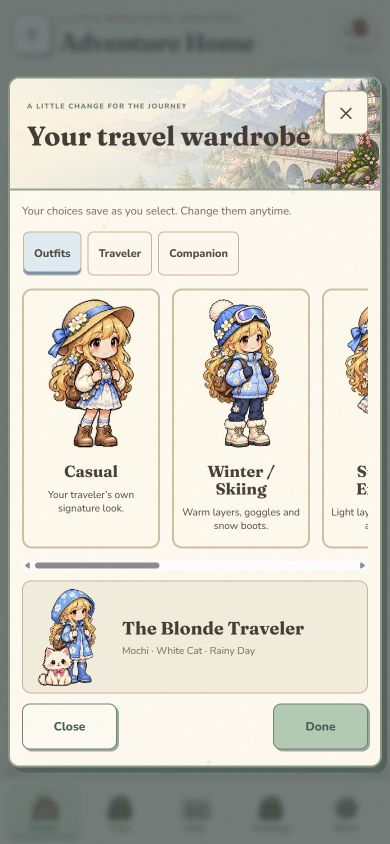

# Character and map verification — 14–15 October 2026

## Implementation

Added two visually distinct traveler identities, two independently selectable pets, six wardrobes per traveler, first-time setup, autosaving wardrobe controls, shared profile migration, optional map character, destination discovery, favorites, map modes and explicit stamp actions. Browser-local travel records keep the original `pixel-passport-v1` key and stable record IDs. Legacy backup imports preserve the current appearance when the backup has no appearance fields.

The supplied blonde reference was used to create isolated transparent artwork. Original PNGs are retained; optimized WebP atlases are delivered. Measured component bounds and explicit SVG clipping prevent neighboring atlas artwork from appearing in cards. Character and pet movement pauses offscreen, when the document is hidden, when an appearance dialog covers the world, or when reduced motion is enabled.

## Browser checks

Used a separate `127.0.0.2` origin at 390 × 844 so testing did not change localhost or public-site travel records.

- Completed the first-time traveler → companion → outfit → review → welcome flow with the blonde and puppy. Reload skipped setup and retained the choices.
- Switched the blonde to Rainy Day and the cat, independently. Reload retained the avatar, pet, outfit and map visibility preference.
- Switched to the brunette while retaining the cat and Rainy Day; then selected the puppy. The selected identity and pet updated immediately without closing the wardrobe or changing travel records.
- Real Geneva search returned Swiss results and actual coordinates. Explore opened a discovery card. Add to trip opened the existing editable form with name, country, status and coordinates. Saved 2–4 February 2027 dates and a test note; the new stop appeared in the map and route list.
- Journey preview displayed St. Gallen → Geneva in saved order, accepted the train symbol and exposed Stop journey. Connection wording explicitly states that geometry and times are unverified.
- Saved Geneva as a favorite. Explicit Mark visited changed the pin status, unlocked Switzerland and added 50 XP. Undo restored planned status and removed that visit's stamp/XP; marking it again restored the real milestone.
- Visited mode and Favorites only showed Geneva as the sole matching saved place. The map traveler continued to display Planning preview.
- Reloaded a pre-upgrade returning profile: no setup dialog appeared; its 11 destinations, 2 packed items, 3 completed quests, Chamonix ski plan, France stamp and $120 actual spending remained visible.
- Removed every scene pause button. The phone homepage remained visible and the button count was zero.
- Captured phone screenshots and compared character identities, outfit cards, spacing and sprite edges against the references. Corrected neighboring sprite leakage with clip paths and tightened map cards for phones.

## Refinements found during testing

1. A delayed reverse geocoder result could overwrite a selected saved-destination card. Pin selection now invalidates that pending discovery request, and marker clicks stop propagation.
2. Wide SVG sprite viewports exposed neighboring artwork through aspect-ratio letterboxing. Each sprite now has a clip matching its measured alpha bounds.
3. A default casual outfit in generic companion panels overrode the selected wardrobe. Those panels now inherit the central profile unless an explicit preview outfit is requested.
4. The map appeared after too many controls on phones. Compact scenery and collapsible journey controls moved it higher; phone destination cards use a short landscape banner.
5. Visited mode now returns to planning mode when another status filter is chosen; selected mode, status, trip and transport preferences persist coherently.

## Touch interaction follow-up

At 390 × 844, Say hello to Pip changed the displayed mode to waving and updated the dialogue. Play with Biscuit independently changed the puppy to walking and displayed its response. Tapping St. Gallen scenery created seven seasonal particles and an accessible breeze announcement; the removed scene pause button count remained zero. Interaction timers clean up on unmount and never save planning records. Reduced-motion CSS suppresses bursts and the shared ambient hook stops sprite animation. Screenshot: `screenshots/phone-interactive.jpg`.

The GitHub destination supplied by the user is `https://github.com/christiiscool/pixelpassport.git`. Initial branch discovery returned no refs, so publication can initialize its main branch without overwriting existing history.

## Automated checks

`npm run check` validates all four application scripts, season/route/linked-cost invariants, additive appearance migrations, new-versus-returning behavior, all 24 independent appearance combinations and truthful destination facts. `npm run build` bundles the React islands successfully.

The previous release's itinerary, packing, quests, ledger and ski linking checks are documented in `living-world-verification.md`; their model gates remain part of the current check command.

## Phone evidence

## Practical limits

Records remain on this browser/device, with JSON backup/import available. Public hosting does not synchronize them. Map tiles and discovery require reachable public providers. No verified route provider is connected, so route movement is explicitly an approximate planning preview and never a booked journey or physical-location claim. Additional outfits use their own standing artwork with CSS reactions and independent props; full action cells are available for each character's signature outfit.
